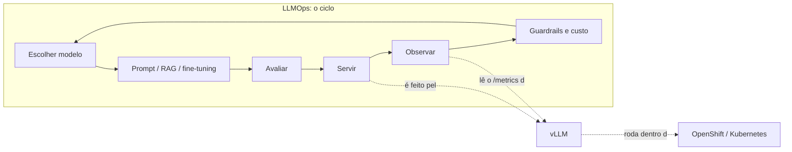

# 01 · Visão geral: LLMOps, vLLM e OpenShift

## Objetivo

Ao terminar, você sabe explicar o que cada uma das três peças faz, como elas se encaixam e quando
**não** usar cada uma.

## As três peças numa frase

| Peça | O que é | Analogia |
|---|---|---|
| **LLMOps** | práticas para colocar e **manter** LLMs em produção: avaliar, servir, observar, proteger, controlar custo e iterar | a "engenharia de confiabilidade" dos LLMs |
| **vLLM** | servidor de inferência open source que roda o modelo e expõe uma API compatível com a OpenAI | o "motor" que transforma pesos em respostas |
| **OpenShift** | plataforma Kubernetes da Red Hat, com segurança e ferramentas de desenvolvedor por padrão | o "prédio" onde o motor roda, com portaria, elevador e câmeras |

## E o MLOps?

LLMOps é um caso particular de **MLOps**, a disciplina mais antiga de colocar *qualquer* modelo de ML em
produção. A [trilha de MLOps](../../mlops/) deste repo ([docs 01](../../mlops/docs/01-mlops-fundamentos.md) a [04](../../mlops/docs/04-mlops-no-openshift-ai.md),
exemplos 01–05) usa um classificador do scikit-learn com MLflow. Começar por ela ajuda a ver o que é
comum às duas e o que é específico de LLM.

## Como se encaixam

O **vLLM** cuida de uma etapa (servir) e alimenta outra (observar, via `/metrics`). O **OpenShift**
dá a infraestrutura: réplicas, rede, segurança, monitoramento. O **LLMOps** é o processo que amarra tudo
e decide quando uma versão nova pode ir para produção (o [projeto final](../projeto-final/) é isso).

## LLMOps × MLOps

LLMOps é MLOps com particularidades. As fontes de referência (Red Hat, Databricks, Google Cloud)
concordam nestes pontos:

- **Você quase nunca treina do zero.** Parte de um *foundation model* e adapta com prompt, RAG ou fine-tuning.
- **O artefato promovido é o pipeline, não só o modelo.** Prompt, template, parâmetros de sampling e
  configuração de RAG precisam ser versionados juntos.
- **Não existe uma resposta única certa.** A avaliação mistura métricas automáticas, casos de regressão e
  feedback humano.
- **Custo de serving domina.** Cada token gerado custa computação; latência e throughput viram requisitos de produto.

## Quando NÃO usar

- **vLLM self-hosted** não compensa com volume baixo e sem requisito de privacidade: uma API paga sai mais
  barata (veja [docs/08](08-custo-e-capacidade.md)). Também não é a ferramenta para rodar um modelo no
  laptop por diversão: Ollama e llama.cpp são mais simples.
- **OpenShift** é pesado para um único serviço pequeno. Ele brilha com muitos times, regras de segurança
  e operação 24×7. Para estudar Kubernetes puro, o kind basta.
- **LLMOps "completo"** (registro de modelos, guardrails, tracing) para um protótipo é sobre-engenharia.
  Comece por avaliação + métricas, como esta trilha faz.

## Alternativas

| Função | Alternativas ao que esta trilha usa |
|---|---|
| Servir LLM | SGLang, TGI (Hugging Face), llama.cpp, Ollama, NVIDIA Triton/TensorRT-LLM |
| Plataforma | Kubernetes puro (EKS, GKE, AKS), Rancher, OKD (o OpenShift comunitário) |
| Serving gerenciado no OpenShift | Red Hat OpenShift AI (KServe + vLLM), llm-d para inferência distribuída |

## Fontes

- Red Hat, *What is LLMOps*: https://www.redhat.com/en/topics/ai/llmops
- Databricks, *LLMOps*: https://docs.databricks.com/aws/en/machine-learning/mlops/llmops
- Google Cloud, *What is LLMOps*: https://cloud.google.com/discover/what-is-llmops
- vLLM: https://docs.vllm.ai/en/latest/
- OpenShift 4.22: https://docs.redhat.com/en/documentation/openshift_container_platform/4.22
