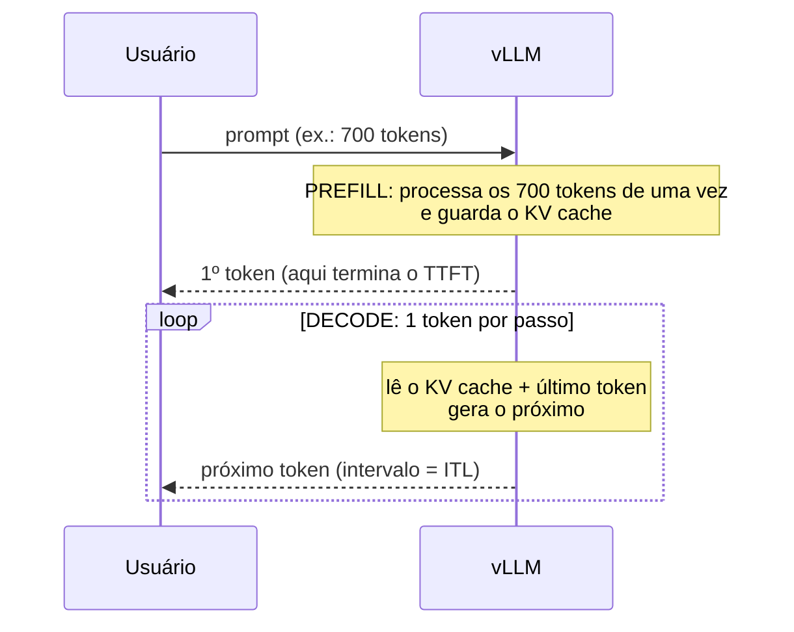

# 03 · Fundamentos de LLM para quem vai operar

## Objetivo

Entender o mínimo sobre **como um LLM gera texto** para conseguir operar um: tokens, prefill, decode,
KV cache e sampling. Sem matemática; com o que muda latência, custo e qualidade.

## Tokens: a unidade de tudo

O modelo não vê letras nem palavras: vê **tokens**, pedaços de texto de um vocabulário fixo
(~150 mil no Qwen2.5). Tudo é medido em tokens: **custo** (preço por 1M tokens), **limite de contexto**
(`--max-model-len`) e **velocidade** (tokens/s).

```
'Kubernetes'                      -> ['K', 'ubernetes']                                  (2 tokens)
'OpenShift orquestra containers.' -> ['Open', 'Shift', ' or', 'que', 'stra', ' containers', '.']  (7 tokens)
```

Português costuma gastar **mais tokens** que inglês, porque os vocabulários são treinados com mais texto
em inglês. Veja no [exemplo 02](../exemplos/02-tokens-e-sampling/).

## As duas fases de uma requisição



| Fase | O que faz | Limitada por | Métrica que sente |
|---|---|---|---|
| **Prefill** | lê o prompt inteiro em paralelo | computação (cresce com o tamanho do prompt) | **TTFT**, tempo até o 1º token |
| **Decode** | gera 1 token por vez, em sequência | leitura de memória (pesos + KV cache) | **ITL / TPOT**, tempo entre tokens |

Regra prática: **prompt longo piora o TTFT; resposta longa piora o tempo total**. No
[exemplo 03](../exemplos/03-streaming-ttft-itl/), um prompt de ~700 tokens levou o TTFT de 0,4 s para 10 s
em CPU, enquanto o ITL ficou parecido.

## KV cache: a memória de curto prazo

Para gerar o token N, a atenção precisa olhar todos os tokens anteriores. Em vez de recalcular tudo a cada
passo, o servidor guarda os vetores **Key** e **Value** de cada token já processado: é o **KV cache**.

- Ele cresce com **tokens × requisições simultâneas**. É o que limita contexto e concorrência.
- Acabou o KV cache? Requisições esperam na fila ou são **preemptadas**. Monitore `vllm:kv_cache_usage_perc`.
- Neste repo: `VLLM_CPU_KVCACHE_SPACE=2` (2 GiB) → o log mostra `CPU KV cache size: 174,720 tokens,
  Maximum concurrency for 4,096 tokens per request: 42.66x`.

## Sampling: como o próximo token é escolhido

A cada passo o modelo dá uma probabilidade para cada token do vocabulário. O sampling escolhe um:

| Parâmetro | Efeito | Quando usar |
|---|---|---|
| `temperature=0` | sempre o mais provável (*greedy*), resposta reprodutível | avaliação, extração, classificação |
| `temperature` 0,7–1,0 | mais variedade | texto criativo, brainstorming |
| `top_p` | sorteia só entre os tokens que somam p% da probabilidade | corta opções absurdas com temperatura alta |
| `seed` | fixa o sorteio | reproduzir um resultado com temperatura > 0 |
| `max_tokens` | corta a resposta (`finish_reason="length"`) | controlar custo e latência |

> O Qwen2.5 traz um `generation_config.json` com padrões próprios (`temperature 0.7`, `top_p 0.8`,
> `repetition_penalty 1.1`) e o vLLM os aplica quando o cliente não manda. Para ignorá-los, suba com
> `--generation-config vllm`. Em produção, **sempre mande os parâmetros explicitamente**.

## Tamanho do modelo e qualidade

O modelo desta trilha tem **0,5 bilhão** de parâmetros: cabe em CPU e responde em ~1 s, mas erra conta
(`12 + 30 = 15`) e inventa fatos com confiança. Isso não é um defeito da trilha, é **o motivo** de
existirem avaliação e guardrails. Em produção, modelos de 7B a 70B em GPU são o comum.

## Armadilhas

- Medir latência sem separar TTFT de ITL: você não sabe se o gargalo é o prompt ou a geração.
- Comparar contagem de tokens entre modelos diferentes: cada tokenizer corta o texto de um jeito.
- Deixar o `max_model_len` no padrão do modelo (32k no Qwen2.5): o KV cache pode não caber.

## Fontes

- PagedAttention / KV cache (paper do vLLM): https://arxiv.org/abs/2309.06180
- NVIDIA, *LLM benchmarking fundamentals* (TTFT, ITL, throughput): https://developer.nvidia.com/blog/llm-benchmarking-fundamental-concepts/
- Parâmetros de sampling no vLLM: https://docs.vllm.ai/en/latest/api/vllm/sampling_params.html
- Modelo: https://huggingface.co/Qwen/Qwen2.5-0.5B-Instruct
