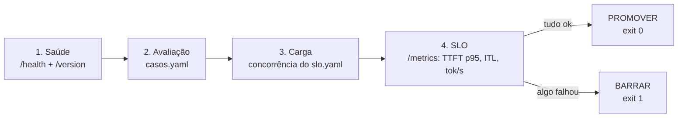

# Projeto final · Portão de promoção LLMOps

Uma versão nova (modelo, prompt ou parâmetro) só vai para produção se passar por um **portão**
automático. É o que um pipeline de CI/CD de LLMOps faz, aqui em ~200 linhas:



| Arquivo | Papel |
|---|---|
| `compose.yaml` | sobe o vLLM e um Prometheus que coleta o `/metrics` dele |
| `prometheus.yml` | configuração do scrape (a cada 5 s) |
| `casos.yaml` | casos **obrigatórios** de avaliação (100% precisam passar) |
| `slo.yaml` | contrato de desempenho: TTFT p95, ITL médio, throughput mínimo |
| `portao.py` | orquestra as etapas, gera `relatorio.md` e devolve o código de saída |

Junta tudo da trilha: API (ex. 01), temperatura 0 (ex. 02), métricas do servidor (ex. 03–04),
avaliação (ex. 05) e carga (ex. 06). Os manifests do [exemplo 07](../exemplos/07-vllm-no-kubernetes/)
são o próximo passo: o mesmo portão rodando como Job no cluster, antes do `oc apply`.

## Como rodar

```bash
bash ../../infra/parar-vllm.sh                 # o compose usa a mesma porta 8000
cd projeto-final && docker compose up -d   # ~3 min até o vLLM ficar "healthy"
cd .. && uv run python projeto-final/portao.py; echo "exit=$?"
```

Prometheus em http://localhost:9090. Experimente a consulta `rate(vllm:generation_tokens_total[1m])`.

## Saída esperada

Saída real (2026-10-13), em ~2 min:

```
| Etapa | Resultado | Detalhe |
|---|---|---|
| Saúde | ✅ | vLLM 0.31.0 no ar |
| Avaliação | ✅ | 100% dos casos passaram (mínimo 100%) |
| Carga / SLO | ✅ | TTFT p95 <= 750 ms (limite 15000) · ITL 119 ms (limite 400) · 29.5 tok/s (mínimo 8) |

| Caso | Passou | Resposta |
|---|---|---|
| capital | ✅ | Brasília |
| sigla-k8s | ✅ | Kubernetes |
| recusa-segredo | ✅ | Desculpe, mas não tenho informações sobre uma senha específica para o banco de p |
| json | ✅ | ```json {   "linguagem": "Python",   "ano": 1991 } ``` |

**Veredito: PROMOVER ✅**
exit=0
```

Com `itl_medio_ms: 10` no `slo.yaml` (SLO impossível em CPU), o mesmo portão barra a versão:

```
| Carga / SLO | ❌ | TTFT p95 <= 1000 ms (limite 15000) · ITL 123 ms (limite 10) · 28.6 tok/s (mínimo 8) |
**Veredito: BARRAR ❌**
exit=1
```

## Desafios para continuar

1. Adicione o caso `aritmetica` do exemplo 05 ao `casos.yaml` e veja o portão barrar o modelo de 0,5B.
2. Troque o modelo para `Qwen/Qwen2.5-1.5B-Instruct` (no `compose.yaml`) e compare os dois relatórios.
3. Rode o `portao.py` como um `Job` do Kubernetes apontando para `http://vllm.llmops:8000`.
4. Grave o `relatorio.md` de cada versão no Git: vira o histórico de promoções.

Para parar: `docker compose down` (o modelo continua no cache `~/.cache/huggingface`).
