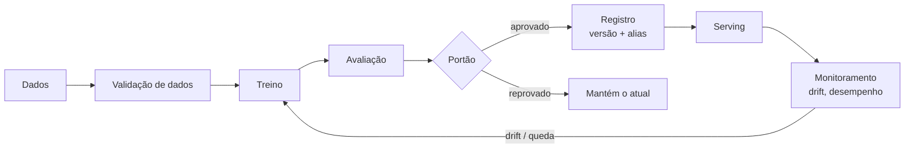

# 10 · MLOps: fundamentos

## Objetivo

Entender o que é MLOps, por que ML em produção é diferente de software comum, os níveis de maturidade e
onde o LLMOps se encaixa.

## O que é

O Google define MLOps como "uma cultura e prática de engenharia de ML que unifica o desenvolvimento (Dev)
e a operação (Ops) de sistemas de ML", com automação e monitoramento em todas as etapas. Em uma frase:
**DevOps para sistemas em que o comportamento vem dos dados, não só do código.**

O artigo *Hidden Technical Debt in Machine Learning Systems* (Google, NeurIPS 2015) tem a figura famosa:
o código do modelo é uma **caixinha pequena** cercada de coleta de dados, validação, features, serving,
monitoramento e configuração. MLOps cuida dessa vizinhança.

## O que muda em relação ao DevOps

| | DevOps | MLOps |
|---|---|---|
| O que se versiona | código | **código + dados + modelo** (e parâmetros) |
| Testes | unitários, integração | + **testes de dados** (esquema, distribuição) + **testes de modelo** (métrica mínima, comparação com o atual) |
| CI | testa e builda o código | também valida dados e modelos |
| CD | entrega um pacote | entrega um **pipeline de treino**, que por sua vez entrega o modelo |
| Novo | — | **CT (continuous training)**: retreinar automaticamente quando os dados mudam |
| Falha típica | erro, exceção, queda | **degradação silenciosa**: o serviço responde, mas cada vez pior (drift) |

## Ciclo de vida

Mapa da trilha: tracking ([ex. 01](../exemplos/01-experimentos-com-mlflow/)) → registro e promoção
([ex. 02](../exemplos/02-registro-e-promocao/)) → serving ([ex. 03](../exemplos/03-servindo-o-modelo/)) →
monitoramento ([ex. 04](../exemplos/04-drift-e-monitoramento/)) → pipeline ([ex. 05](../exemplos/05-pipeline-de-treino/)).

## Níveis de maturidade (Google)

| Nível | Como é | Sinal de que você está nele |
|---|---|---|
| **0 · Manual** | notebooks e scripts; o cientista "entrega" o modelo para a engenharia | poucos releases por ano, sem monitoramento, "qual notebook gerou isso?" |
| **1 · Pipeline automatizado** | o treino é um pipeline orquestrado, com validação de dados e de modelo; retreino por agenda ou gatilho (CT) | o que vai para produção é o **pipeline**, não um arquivo de modelo |
| **2 · CI/CD do pipeline** | o próprio pipeline passa por build, teste e deploy automáticos | mudanças no código de treino chegam a produção com segurança e frequência |

O [exemplo 05](../exemplos/05-pipeline-de-treino/) é um nível 1 em miniatura. A Microsoft usa uma escala
parecida, de 0 a 4.

## MLOps × LLMOps

LLMOps ([visão geral da trilha de LLMOps](../../llmops-vllm-openshift/docs/01-visao-geral.md)) é MLOps aplicado a LLMs, com diferenças de ênfase:

| | MLOps clássico | LLMOps |
|---|---|---|
| Modelo | você **treina** (scikit-learn, XGBoost...) | você quase sempre **adapta** um modelo pronto (prompt, RAG, fine-tuning) |
| Avaliação | métrica objetiva com rótulo (recall, AUC) | texto livre: regras, LLM-as-judge, humanos |
| Artefato versionado | dados + código + modelo | + **prompt** e parâmetros de sampling |
| Serving | barato (ms, CPU) | caro (GPU, tokens, KV cache) |
| Monitoramento | drift de dados e de previsão | latência (TTFT/ITL), custo por token, qualidade, segurança |

O que é igual: **versionar tudo, avaliar antes de promover, observar em produção e ter um portão automático.**

## Armadilhas

- **Vazamento de dados (*data leakage*)**: dar `fit` no scaler antes do split. Ponha o pré-processamento dentro de um `Pipeline`.
- **Training-serving skew**: pré-processar de um jeito no treino e de outro no serving. Salve o pipeline inteiro como modelo.
- **Avaliar no conjunto de treino** ou "espiar" o teste várias vezes.
- **Só acurácia com classes desbalanceadas** ([exercício 01](../exercicios/01-escolher-a-metrica/)).
- **Não fixar seeds** (`random_state`): resultados que não se repetem não se comparam.
- **Não versionar os dados**: sem saber com que dados o modelo treinou, não dá para reproduzi-lo.

## Fontes

- Google Cloud, *MLOps: continuous delivery and automation pipelines in ML*: https://docs.cloud.google.com/architecture/mlops-continuous-delivery-and-automation-pipelines-in-machine-learning
- Microsoft, MLOps maturity model: https://learn.microsoft.com/en-us/azure/architecture/ai-ml/guide/mlops-maturity-model
- Sculley et al., *Hidden Technical Debt in Machine Learning Systems*: https://papers.nips.cc/paper_files/paper/2015/hash/86df7dcfd896fcaf2674f757a2463eba-Abstract.html
- scikit-learn, *Common pitfalls*: https://scikit-learn.org/stable/common_pitfalls.html
- Google, *Rules of ML*: https://developers.google.com/machine-learning/guides/rules-of-ml
